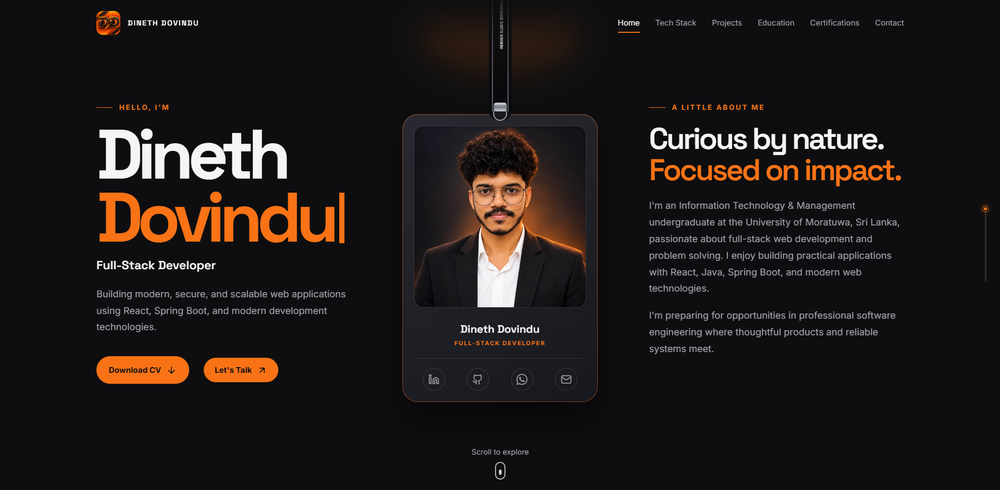
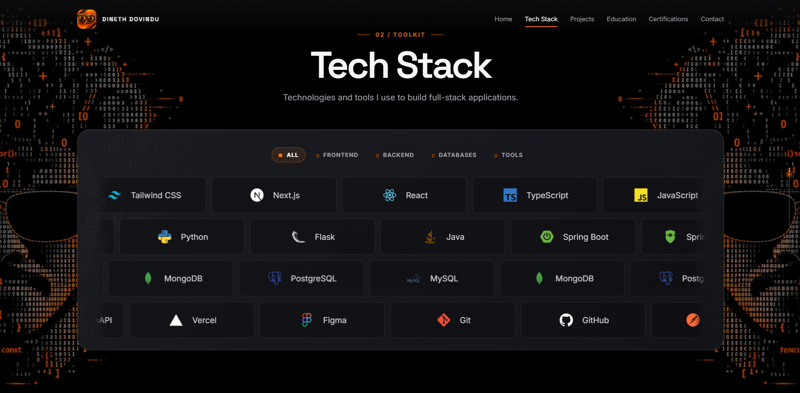

# Dineth Dovindu — Portfolio

Personal portfolio website for **Dineth Dovindu**, a full-stack developer from Sri Lanka. The site presents selected projects, technical skills, education, certifications, and contact details in a responsive dark interface.

**Live site:** [kdinethdovindu.is-a.dev](https://kdinethdovindu.is-a.dev/)

## Screenshots

<p align="center">
  
  
</p>

## Features

- Responsive layout for desktop, tablet, and mobile screens
- Animated loading experience and scroll-based section reveals
- Interactive hanging profile card with social links
- Filterable, animated technology stack showcase
- Horizontal featured-project gallery with image lightbox previews
- Education and certification timelines
- Contact form powered by Formspree with an email fallback
- Reduced-motion support for users who prefer less animation
- Downloadable CV and links to GitHub, LinkedIn, and WhatsApp

## Built with

- React 18 and TypeScript
- Vite
- Motion for React
- Lenis smooth scrolling
- Lucide React and React Icons
- Formspree
- CSS with responsive custom properties and animations

## Getting started

### Requirements

- Node.js 18.18 or newer
- npm

### Installation

```bash
git clone https://github.com/kdinethdovindu/Portfolio.git
cd Portfolio
npm install
```

Start the development server:

```bash
npm run dev
```

The site will be available at the local URL shown by Vite, usually `http://localhost:5173`.

## Available scripts

| Script | Purpose |
| --- | --- |
| `npm run dev` | Start the Vite development server |
| `npm run build` | Type-check and create a production build |
| `npm run preview` | Preview the production build locally |
| `npm run typecheck` | Run the TypeScript compiler without emitting files |
| `npm run lint` | Run ESLint checks |
| `npm run check` | Run type-checking, linting, and the production build |

Run the full validation check before deploying:

```bash
npm run check
```

## Contact form configuration

The contact form uses [Formspree](https://formspree.io/).

1. Create a form in Formspree and copy its form ID.
2. Copy `.env.example` to `.env`.
3. Add the form ID:

   ```env
   VITE_FORMSPREE_FORM_ID=your-form-id
   ```

4. Add the same variable to the environment settings of your hosting provider.

If the variable is not set, the form shows a setup message and visitors can still contact you through the email fallback.

## Project structure

```text
.
├── public/
│   ├── images/              # Portrait, project, education, certificate, and stack assets
│   ├── resume/              # Downloadable CV
│   ├── DD_Logo.png
│   └── DD_Loading_Page.webp
├── src/
│   ├── App.tsx              # Page layout and interactive components
│   ├── data.ts              # Portfolio content and links
│   ├── styles.css            # Global styles and responsive layout
│   └── useSmoothScroll.ts    # Smooth-scroll setup
├── index.html
└── package.json
```

## Updating the content

Most portfolio content can be edited in [src/data.ts](./src/data.ts):

- Personal details and social links
- Navigation labels
- Technology stack items
- Featured projects, GitHub links, and live demos
- Education history
- Certifications and credential links
- CV availability and file path

Static assets are stored in `public/images/`. Replace an asset there and update its path in `src/data.ts` when needed.

## Deploying to Vercel

1. Push the repository to GitHub.
2. Import it into [Vercel](https://vercel.com/).
3. Keep the detected Vite settings:
   - Build command: `npm run build`
   - Output directory: `dist`
4. Add `VITE_FORMSPREE_FORM_ID` under the project environment variables.
5. Deploy.

## License

This repository contains personal portfolio content and artwork. Contact the author before reusing the content or assets.

## Connect

- Email: [kdinethdovindu@gmail.com](mailto:kdinethdovindu@gmail.com)
- GitHub: [kdinethdovindu](https://github.com/kdinethdovindu)
- LinkedIn: [Dineth Dovindu](https://www.linkedin.com/in/dineth-dovindu-ba801a383/)
- Portfolio: [kdinethdovindu.is-a.dev](https://kdinethdovindu.is-a.dev/)
- Location: Sri Lanka
